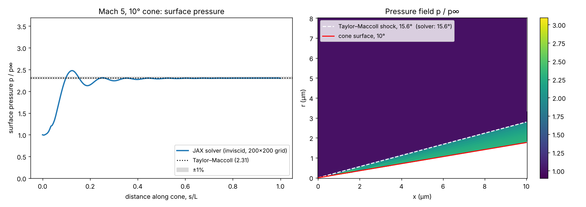

# Supersonic flow over a cone (JAX)

Solver for viscous, compressible, axisymmetric flow over a 10° cone at Mach 5, written in JAX. It extends a MATLAB MacCormack solver for supersonic flow over a wedge ([Super-Sonic-Flow-over-Wedge](https://github.com/tejasbg004/Super-Sonic-Flow-over-Wedge)) to an axisymmetric cone.

## Method

- Axisymmetric compressible Navier–Stokes equations in strong conservation form
- **MacCormack** explicit predictor–corrector scheme (second order in space and time)
- **Curvilinear grid transformation** $(x, r) \to (\xi, \eta)$ with metrics and Jacobian $J = x_\xi r_\eta - x_\eta r_\xi$; the conserved variables, fluxes and the axisymmetric source term are all weighted by $J$
- Sutherland's law for viscosity; no-slip, isothermal wall; supersonic inflow and extrapolated outflow

## Running

```bash
pip install jax matplotlib numpy scipy
python JAX_Supersonic_Cone_Solver.py        # 100 x 100 grid, 3000 steps; plots go to outputs/
```

`cone_solver_live.ipynb` runs the same solver with live plots.

## Validation against Taylor–Maccoll

With viscosity switched off and a slip wall, the same scheme reproduces the inviscid Taylor–Maccoll conical-flow solution for Mach 5 and a 10° cone:

| | Taylor–Maccoll | Solver (200 × 200) |
|---|---|---|
| Shock angle | 15.61° | 15.58° |
| Surface pressure $p/p_\infty$ | 2.308 | 2.304 (within 0.5% for $s/L > 0.6$) |



To reproduce (takes a while on a CPU):

```bash
python validation/run_taylor_maccoll.py           # full run
python validation/run_taylor_maccoll.py --quick   # short smoke test
```

`validation/harness.py` reuses the solver's derivative, flux, metric and source functions and adds switches for an inviscid slip wall and pressure-switched artificial dissipation; `validation/references.py` integrates the Taylor–Maccoll equation.

With viscosity on, the surface pressure is higher than the inviscid value because of viscous interaction (boundary-layer displacement), which grows as the Reynolds number falls.

## Note on the source term

An earlier version multiplied the axisymmetric source term by 1 instead of by the Jacobian $J$:

```python
S = jnp.zeros_like(U).at[2].set(J * S2)   # was .set(S2)
```

The conserved variables and fluxes are scaled by $J$, so the source term must be too. Without it, a uniform flow is not preserved on the sheared grid and the solution carries a spurious radial force.
